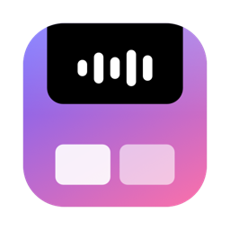
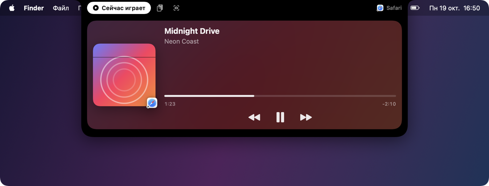
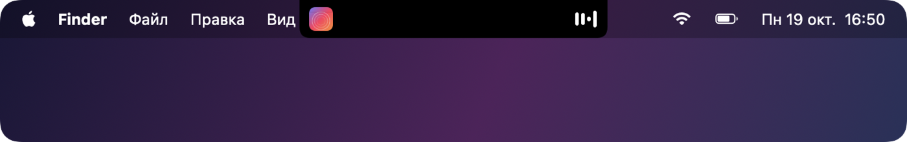
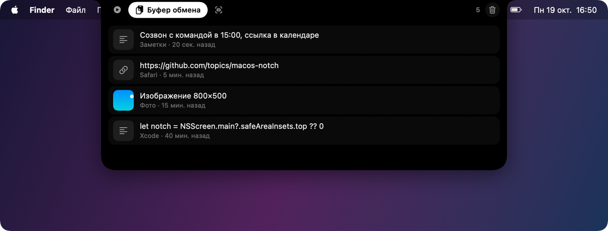
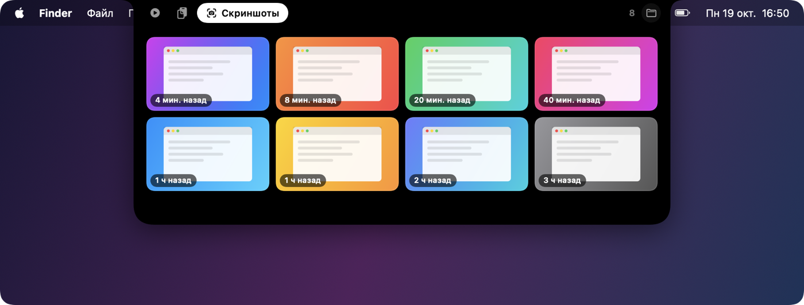
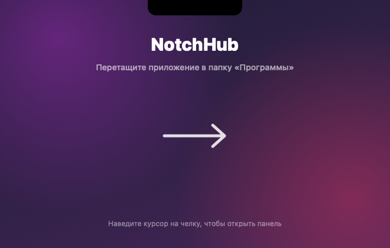

<div align="center">



# NotchHub

**Челка MacBook, которая наконец-то делает что-то полезное.**

Наведите курсор на вырез экрана — и он раскроется в мини-панель с плеером,
историей буфера обмена и недавними скриншотами.


<picture>
  <source media="(prefers-color-scheme: light)" srcset="docs/images/media-light.png">
  
</picture>

</div>

---

## ✨ Возможности

### 🎵 Сейчас играет
Показывает любое активное медиа: **YouTube, Яндекс Музыку, SoundCloud, Spotify, Apple Music**,
фильмы и сериалы на любом сайте — всё, что macOS видит в «Сейчас играет».

- обложка, название, исполнитель и иконка источника;
- **временная шкала** с перемоткой — просто перетащите ползунок;
- кнопки **назад / пауза / вперёд**;
- клик по обложке открывает приложение-источник.

Пока что-то играет, вокруг свёрнутой челки живёт мини-индикатор с обложкой и эквалайзером:

<picture>
  <source media="(prefers-color-scheme: light)" srcset="docs/images/collapsed-light.png">
  
</picture>

### 📋 Буфер обмена
История последних 60 копирований: текст, ссылки, картинки и файлы.
Клик — и запись снова в буфере. Пароли из менеджеров паролей не сохраняются.

<picture>
  <source media="(prefers-color-scheme: light)" srcset="docs/images/clipboard-light.png">
  
</picture>

### 📸 Недавние скриншоты
Свежие снимки экрана сеткой. Клик — открыть, перетаскивание — сразу в Telegram,
браузер или Finder. Через контекстное меню можно скопировать, показать в Finder или удалить.

<picture>
  <source media="(prefers-color-scheme: light)" srcset="docs/images/screenshots-light.png">
  
</picture>

### 🌗 Светлая и тёмная тема
Панель подстраивается под оформление системы на лету. Свёрнутая челка всегда остаётся
чёрной — чтобы сливаться с аппаратным вырезом.

### 🪄 Анимации
Пружинное раскрытие из выреза, плавные переходы между вкладками, появление списков «лесенкой»,
анимированные иконки и эквалайзер.

---

## 📦 Установка

1. Соберите установщик (нужны Command Line Tools: `xcode-select --install`):
   ```bash
   ./build.sh
   ```
2. Откройте `build/NotchHub-1.0.dmg` и перетащите **NotchHub** в папку «Программы».

   

3. При первом запуске macOS предупредит о неизвестном разработчике: нажмите на
   приложение правой кнопкой → **Открыть**.

NotchHub живёт без иконки в Dock. Выйти или очистить историю можно через значок в строке меню.

## 🛠 Как это устроено

| Часть | Реализация |
| --- | --- |
| Окно | `NSPanel` поверх строки меню, не забирает фокус; наведение отслеживается по положению курсора |
| Форма челки | своя `Shape` с анимируемыми радиусами |
| Буфер обмена | опрос `NSPasteboard.changeCount`, история в `~/Library/Application Support/NotchHub` |
| Скриншоты | Spotlight (`kMDItemIsScreenCapture`) + наблюдение за папкой снимков |
| Медиа | приватный `MediaRemote.framework` через маленький мост `Helper/NowPlaying.m` |

> [!NOTE]
> С macOS 15.4 Apple отдаёт данные «Сейчас играет» только своим процессам. Поэтому мост
> загружается в системный `/usr/bin/perl`, а приложение читает из него JSON. Это неофициальный
> способ, и в будущих версиях macOS он может перестать работать.

### Структура

```
Sources/NotchHub/   приложение (AppKit + SwiftUI)
Helper/             мост к MediaRemote
scripts/            генерация иконки и фона установщика
build.sh            сборка .app и .dmg
```

### Картинки для README

Скриншоты выше рисуются самим приложением на демо-данных:

```bash
swift build -c release && .build/release/NotchHub --snapshot docs/images --demo
```

## Требования

- macOS 14 Sonoma или новее
- MacBook с челкой (на других экранах панель появится по центру строки меню)

## Лицензия

[MIT](LICENSE)
